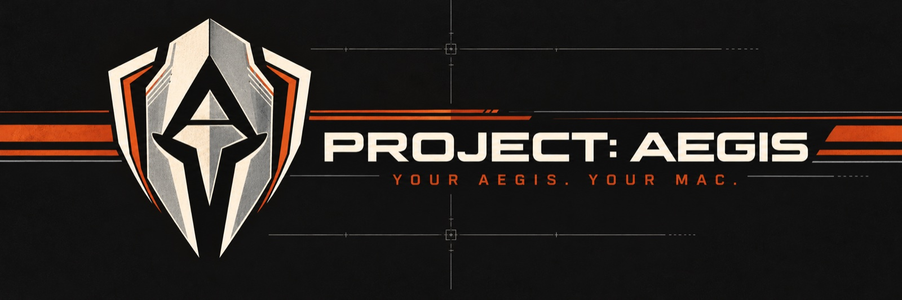

<p align="center">
  
</p>

<p align="center">
  <a href="https://github.com/apotheoticstudios/aegis/actions/workflows/ci.yml"></a>
  
  
  
  <a href="LICENSE"></a>
</p>

<p align="center">
  <b>A private, Iron Man–style assistant for macOS that runs entirely on your Mac.</b><br>
  <sub>It reads your messages, email, notifications and calendar, works out what matters with local AI models,<br>and shows it in a sci-fi HUD. Nothing leaves the machine.</sub>
</p>

---

## ▌ Overview

Your assistant is **your Aegis**. Give it a personal name, a style and a form of address in Personality settings, and it learns the rest as you use it. Open the panel or say **"Hey Aegis"**, and it's there. Close it, and it's silent.

> **Status: early, in active development.** Everything below works end to end on a development Mac. There's no installer yet; the setup wizard is next.

## ▌ What it does

| | |
| --- | --- |
| **The brief** | A morning and evening brief: who's waiting on you, what you said you'd do, what's done today, today's calendar and reminders. Noise, junk and bulk mail stay out. |
| **Conversation** | Ask anything by text or voice. Spoken answers with a bundled on-device voice, natural interruptions, instant answers for time, dates, maths and conversions. |
| **Wake word** | "Hey Aegis", on-device keyword spotting, with a spoken acknowledgement when it's listening. |
| **Memory** | Remembers what you tell it and learns facts automatically; recall blends word matching with a small on-device embedding model, and it periodically reflects on what it knows. |
| **Rules and skills** | VIP and keyword rules in plain language, suggested rules, mutes, `SKILL.md` skills and a morning routine that learns what you switch off. |
| **The HUD** | A frosted-glass, three-column panel with a live 3D arc reactor that only renders while you can see it. |
| **World view** | A full 3D globe of public data (God's Eye View) inside the panel, steered by voice: every layer and action, with Aegis as its voice. |
| **Safety** | Collected content is data, never instructions: prompt-injection scanning, taint tracking, credential stripping, confirmation tiers and an action log. |

## ▌ Principles

1. **Local and private.** Your data and the AI that reads it never leave your Mac.
2. **Silent until opened.** No sounds, notifications or visible UI while the panel is closed.
3. **Light.** Always-on processes stay within a 3 GB idle budget; the large model loads on demand and unloads after use.
4. **Acts only on your command.** Nothing in an email, message or web page can trigger an action.
5. **Thoughtless.** After setup, it starts, heals and updates itself.

## ▌ Architecture

```
┌──────────────── Aegis.app ────────────────┐
│  Menu bar · HUD panel · voice · wake word │      ┌───────────────────────────┐
│  World view (God's Eye View, on demand)   │◀XPC─▶│ AegisCore  (launch agent) │
└───────────────────────────────────────────┘      │ collectors · rules · brief│
                     │                             │ memory · SQLite           │
                    XPC                            └─────────────┬─────────────┘
                     ▼                                          XPC
           ┌──────────────────┐                                  ▼
           │ AegisVoice (TTS) │                   ┌──────────────────────────────┐
           └──────────────────┘                   │ ModelService  (on demand)    │
                                                  │ MLX chat model · embeddings  │
                                                  └──────────────────────────────┘
```

| Part | Role |
| --- | --- |
| [`Packages/AegisKit`](Packages/AegisKit) | The Linux-testable core: contracts, engine, rules, memory, skills, safety, storage |
| [`Apps/AegisApp`](Apps/AegisApp) | Menu bar app, HUD panel, voice, wake word, World view |
| [`Apps/AegisCore`](Apps/AegisCore) | Always-on launch agent: collectors, rules, the brief, the database |
| [`Apps/ModelService`](Apps/ModelService) | On-demand MLX model service that exits to free memory |
| [`Packages/SharedIPC`](Packages/SharedIPC) | Code-signed XPC between the processes |

## ▌ Getting started

Requires a Mac with Apple silicon, macOS 15 or later, and Xcode.

```bash
make bootstrap   # first time: tools, git hooks, Xcode project
make test-core   # fast core tests (works on Linux too)
make test        # full app build and tests
make guard       # privacy guard
make app         # the installable, signed Aegis.app with the on-device model
```

Development and tests use synthetic data in [`Fixtures/`](Fixtures) only.

## ▌ Contributing

Contributions are welcome, from code and tests to docs and ideas.

| If you are… | Read |
| --- | --- |
| Contributing | [`CONTRIBUTING.md`](CONTRIBUTING.md) |
| Reporting a security or privacy problem | [`SECURITY.md`](SECURITY.md) |
| An AI agent | [`AGENTS.md`](AGENTS.md), then [`docs/STATUS.md`](docs/STATUS.md) |
| Looking for the spec | [`docs/design/DESIGN.md`](docs/design/DESIGN.md) |
| Planning work | [`docs/workflow/MULTI_AGENT.md`](docs/workflow/MULTI_AGENT.md) |

Aegis is built by a maintainer working with AI agents: Claude (Mac builds, planning, integration), Codex (Linux-buildable work and reviews), ChatGPT and DeepSeek (research and second opinions), plus contributors.

## ▌ Licence

MIT, see [`LICENSE`](LICENSE). Third-party code keeps its own licence: [`THIRD_PARTY_NOTICES.md`](THIRD_PARTY_NOTICES.md).

<p align="center">
  <br>
  <sub><b>YOUR AEGIS. YOUR MAC.</b></sub>
</p>
